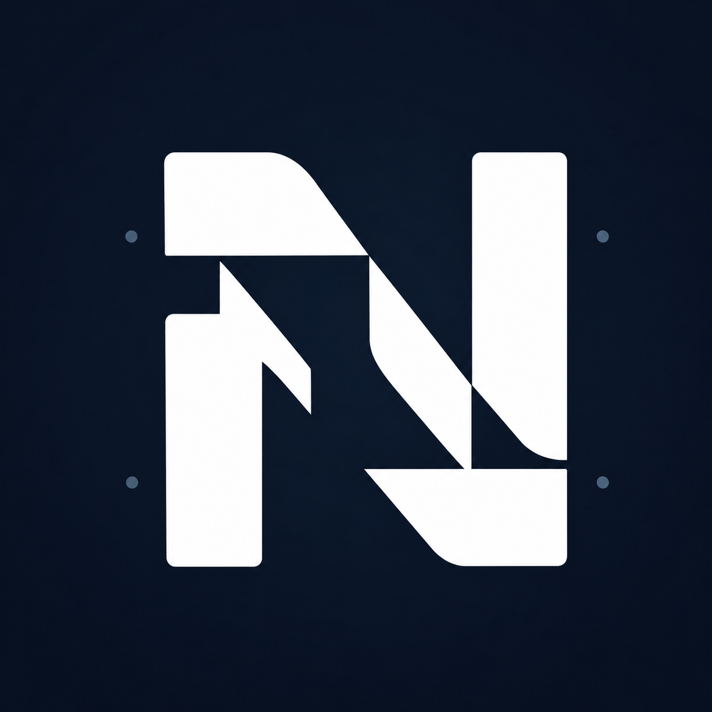

# Nexia Launcher

**Launcher Minecraft Java viết bằng Rust — giao diện native, nhẹ, không Electron, không webview.**

Nexia Launcher là launcher Minecraft Java dành cho cộng đồng **NCA** ([nonca.tokyo](https://nonca.tokyo/)), giao diện tối theo phong cách nonca.tokyo: nền navy, accent xanh thép, card bo tròn, animation nhẹ.

## Tính năng

- **Viết bằng Rust**: tiết kiệm bộ nhớ, khởi động nhanh và tối ưu hơn so với launcher dùng Electron/webview.
- **Loader đầy đủ**: Vanilla, Fabric, Quilt, Forge, NeoForge.
- **Mod Library**: tìm và cài mod từ Modrinth, tự lọc theo phiên bản + loader và tự cài dependency.

## Tải về

Vào mục **Releases** để tải `Nexia-Launcher-Setup-x.y.z.exe` (installer) hoặc `Nexia-Launcher.exe` (chạy trực tiếp).

> Windows SmartScreen có thể cảnh báo vì file chưa có chữ ký số. Chọn **More info → Run anyway**.

## Dữ liệu người dùng

Lưu trong thư mục dữ liệu của hệ điều hành (nút **Mở thư mục dữ liệu** trong Cài đặt):

| Thư mục / file | Nội dung |
|---|---|
| `instance/` | Thư mục game: `mods/`, `saves/`, `resourcepacks/`… |
| `libraries/`, `assets/`, `versions/` | File game do launcher quản lý |
| `config.json` | Cấu hình và phiên đăng nhập |

Trên Windows, token được mã hóa bằng DPAPI theo người dùng hiện tại. Trên Linux/macOS, file có quyền `600` nhưng token không mã hóa. **Không chia sẻ `config.json`.**

## Hạn chế hiện tại

- Tự tải Java chỉ hỗ trợ Windows.
- Chỉ hỗ trợ bản *release*; một instance duy nhất.
- Forge trước 1.13 và NeoForge 1.20.1 chưa hỗ trợ; chưa hỗ trợ OptiFine độc lập, LiteLoader, Legacy Fabric.
- Skin Offline/Ely.by trong game chỉ hoạt động với Fabric.
- Skin cục bộ chỉ hiển thị ở client của bạn, không vượt qua xác thực server online-mode.
- Chưa có cape và icon mod.

Chi tiết các thay đổi theo từng phiên bản xem trong [`UI-CHANGES.md`](UI-CHANGES.md).

## Credits

- **Rei** — nhà phát triển Nexia Launcher · [stellarei.id.vn](https://stellarei.id.vn/)
- Danh sách đầy đủ: <https://nonca.tokyo/credits/>

Xây dựng với [Rust](https://www.rust-lang.org/), [egui / eframe](https://github.com/emilk/egui), [Modrinth](https://modrinth.com/), [Eclipse Adoptium](https://adoptium.net/), [CustomSkinLoader](https://github.com/xfl03/MCCustomSkinLoader).

## Tuyên bố

Nexia Launcher là dự án cộng đồng, **không liên kết với Mojang Studios, Microsoft hay Ely.by**. Minecraft là thương hiệu của Mojang Studios.

## Giấy phép
[MIT](https://github.com/Zero12RB/Project-Nexia/tree/main?tab=MIT-1-ov-file)
